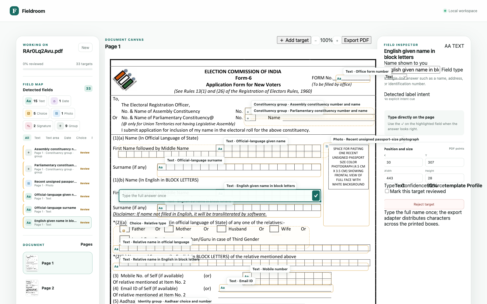
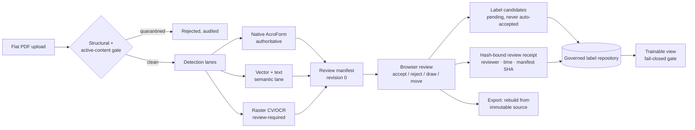
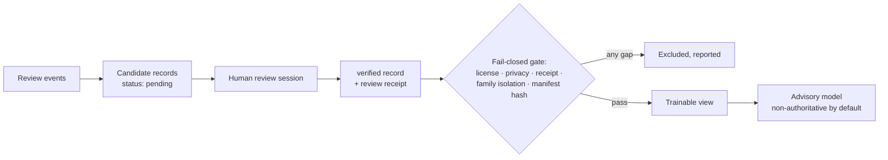

# Fieldroom

**Local-first detection and editable reconstruction of form fields in flat PDFs — with a governed, receipt-backed review pipeline.**

Most PDFs are flat: the visual form exists, but no fillable field does. Fieldroom reads those pages, proposes editable regions across multiple detection lanes, lets a human review every proposal in the browser, and exports a genuinely fillable PDF — while recording *who decided what, when, against which revision* at every step.



> **Native AcroForm fields are authoritative.** Anything the detectors infer is a *candidate* that stays review-required until a human accepts it. Fieldroom never claims a heuristic guess is a real form field.

---

## How it works

Flat pages enter through parallel detection lanes; everything converges in a review manifest; a hash-bound receipt records each human decision; accepted manifests rebuild the export from the immutable source.



**Detection lanes.** Native AcroForm widgets are read as-is and stay authoritative. Vector geometry and text semantics propose fields for painted forms. A raster lane (OpenCV + Tesseract) handles scanned pages — its output is always review-required.

**Review with receipts.** Every accept, reject, move, or manual draw emits a candidate event carrying the reviewer, timestamp, resulting manifest hash, and a disagreement signal (`detector-miss`, `false-positive`, `geometry-correction`, …). Each batch writes a [hash-bound receipt](docs/open-items.md) binding all of that to the exact candidate block — an integrity chain, deliberately not a cryptographic signature.

**Fail-closed by construction.** Malformed, encrypted, or active-content PDFs (JavaScript, embedded files, XFA, open actions) are quarantined with named reasons and an audit trail — never partially processed. The [quarantine policy](docs/security-quarantine-policy.md) documents every gate.

**Training data you can audit.** Review candidates flow into a governed label repository. A model can only consume a generated *trainable view* whose receipt proves license, privacy class, reviewer receipt, and family isolation for every record. By default that view is empty — no model trains on anything a human has not verified.



## Quickstart

```bash
git clone https://github.com/pranaysuyash/fieldroom.git
cd fieldroom
python3 -m venv .venv && source .venv/bin/activate
pip install -e ".[dev,cv,ocr]"

# system OCR (macOS: brew install tesseract)
uvicorn pdf_field_lab.server:app --port 8787
```

Open `http://127.0.0.1:8787`, drop in a flat PDF, and review what the detectors found. Everything stays on your machine — sessions live in your temp directory and expire on a TTL.

Run the checks:

```bash
pytest --cov=pdf_field_lab   # 98 tests, 85% coverage ratchet
ruff check .
```

## What makes this repo different

The engineering is the easy part to describe; the discipline is the point. This project is developed against an [open items register](docs/open-items.md) where every capability states its acceptance evidence and falsifier, separated into five evidence tiers (static inspection → deterministic tests → local API → local browser → production). Claims do not graduate tiers without new evidence.

Highlights of the governance machinery:

- **[Open items register](docs/open-items.md)** — dependency-ordered, per-item acceptance criteria, drift-checked against the code every milestone.
- **[Review receipts](docs/open-items.md)** — hash-bound reviewer/time/revision provenance for every human decision (FFL-HQ-006).
- **[Quarantine policy](docs/security-quarantine-policy.md)** — fail-closed upload gates with an operator-visible audit ledger (FFL-SEC-010).
- **[Label governance](data/labels/README.md)** — licenses, provenance, family isolation, and a training gate that refuses an unauditable view (FFL-GOV-001).
- **[Evaluation contract](docs/detection-benchmark.md)** — order-invariant matching with wrong-label counterexamples as a first-class failure class (FFL-EVL-005).
- **[Learning ledger](docs/learning-ledger.md)** — the reusable lessons and falsifiers behind each gate.

## Project docs

| Doc | What it holds |
|---|---|
| [`docs/open-items.md`](docs/open-items.md) | Canonical status register — what is open, closed, and why |
| [`docs/security-quarantine-policy.md`](docs/security-quarantine-policy.md) | Upload gates, audit ledger, session lifecycle |
| [`docs/detection-benchmark.md`](docs/detection-benchmark.md) | Evaluation contract and benchmarks |
| [`docs/learning-ledger.md`](docs/learning-ledger.md) | Method rationale and falsifiers per gate |
| [`docs/exploration/`](docs/exploration/) | Research records: questions, methods, falsifiers |
| [`data/labels/README.md`](data/labels/README.md) | Label repository safety rules and dataset licenses |

## Status

Active research prototype. Deterministic lanes are solid locally (full test suite, coverage ratchet, review-and-export flow proven end to end); real-world scanned-form recall and a document-disjoint gold set are the honest open frontiers — tracked publicly in the register rather than claimed here.

## Provenance & license

Fieldroom is the public continuation of an internal research project begun in September 2026. The tree you see is a sanitized mirror of that working repository; the docs above are the unedited working record.

Licensed under the [MIT License](LICENSE).
